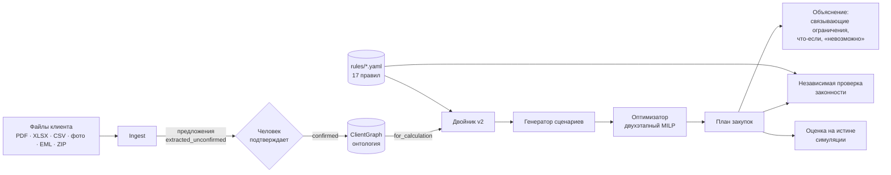
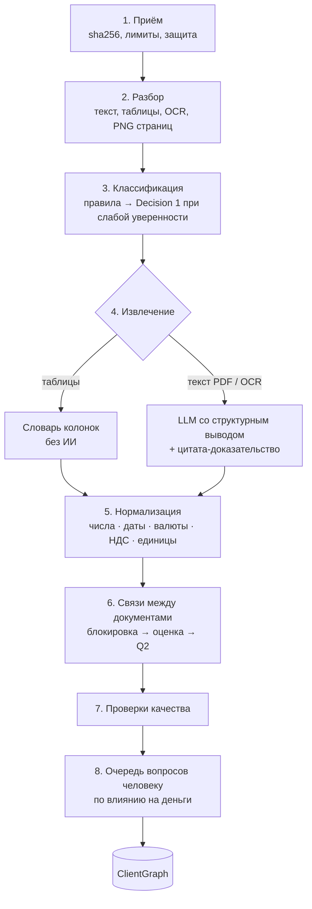

<div align="center">

# LAGRANGE Rx

**От кучи документов импортёра до законного и доказуемо лучшего плана закупок лекарства**

Задача №16 Национального AI-хакатона (Ташкент): прибыльность импортёра рецептурного препарата при референтных ценах (приказ Минздрава РУз №3735).

`документы` → `Ingest` → `подтверждение человеком` → `ClientGraph` → `двойник` → `оптимизатор` → `проверка законности` → `оценка на истине`

</div>

> [!WARNING]
> **Рабочий прототип, а не продукт для бизнес-решений.** Правила закона перенесены из спецификаций и машинного перевода приказа №3735; нужна юридическая проверка носителем узбекского. Реальные юридические и бизнес-выводы остаются **непроверенными (UNVERIFIED)**.

---

## Содержание

1. [Что это и зачем](#1-что-это-и-зачем)
2. [Как это работает: весь путь данных](#2-как-это-работает-весь-путь-данных)
3. [Ingest: документы → подтверждённые данные](#3-ingest-документы--подтверждённые-данные)
4. [ИИ в проекте: где он есть и где его нет](#4-ии-в-проекте-где-он-есть-и-где-его-нет)
5. [Онтология и `ClientGraph`](#5-онтология-и-clientgraph)
6. [Ядро: двойник, сценарии, оптимизатор](#6-ядро-двойник-сценарии-оптимизатор)
7. [Независимая проверка законности](#7-независимая-проверка-законности)
8. [Симуляция и оценка на истине](#8-симуляция-и-оценка-на-истине)
9. [API](#9-api)
10. [Интерфейс](#10-интерфейс)
11. [Быстрый старт](#11-быстрый-старт)
12. [Конфигурация](#12-конфигурация)
13. [Безопасность и лимиты](#13-безопасность-и-лимиты)
14. [Тесты, CI и деплой](#14-тесты-ci-и-деплой)
15. [Структура репозитория](#15-структура-репозитория)
16. [Результаты](#16-результаты)
17. [Что реально, что допущение](#17-что-реально-что-допущение)
18. [Известные проблемы](#18-известные-проблемы)
19. [Документация](#19-документация)

---

## 1. Что это и зачем

Импортёр рецептурных лекарств в Узбекистане работает под **потолками цен**: реестр предельных цен, правило надбавки 15% к законной базе, розничная цепочка. Потолки индексируются, пересматриваются (в июле 2026 кардиопрепараты упали до −37%), а курс сума к доллару плавает. При этом документы компании это хаос: сканы, фото, Excel разных отделов, расхождения между КП и договором.

LAGRANGE Rx отвечает на три вопроса:

| Вопрос | Как отвечает система |
|---|---|
| **Что у клиента на самом деле?** | Читает документы, показывает, что поняла, где сомневается и почему. Ничего не попадает в расчёт без подтверждения человеком. |
| **Какой план закупок лучший и законный?** | Двухэтапная стохастическая оптимизация (MILP) по сценариям курса, потолков, фрахта и сбоев поставщиков. Результат проверяет отдельный независимый модуль. |
| **Насколько можно этому верить?** | Эффект измеряется на «истине» симуляции: прирост к клиенту, VSS, EVPI, regret по уровням беспорядка. Если данных не хватает, система говорит «невозможно, и вот почему». |

### Четыре правила, которые нельзя нарушать

1. **Каждое значение с доказательством.** Документ, страница, точная цитата.
2. **ИИ предлагает, код проверяет, человек подтверждает.** До подтверждения всё имеет статус `extracted_unconfirmed` и в расчёт не идёт.
3. **Честное «не знаю» лучше выдумки.** Нет значения или оно нечитаемо: создаётся `DataQualityIssue`, а не догадка.
4. **Все числа считает код.** В ядре расчётов нет LLM. Законные ограничения никогда не ослабляются.

---

## 2. Как это работает: весь путь данных



| Этап | Вход | Выход | Где в коде |
|---|---|---|---|
| **Ingest** | файлы | предложения экземпляров онтологии, замечания к данным, очередь вопросов | `src/lagrange_rx/ingest/`, `api/ingest.py` |
| **Подтверждение** | очередь вопросов | `confirmed` значения | `ingest/review.py`, UI |
| **Commit** | подтверждённые группы | `ClientGraph` + снимок (sha256) | `ingest/commit.py` |
| **Двойник** | `graph.for_calculation()` | юнит-экономика по маршрутам, калибровка | `engine/twin.py` |
| **Сценарии** | история курса, правила индексации, надёжность | 1000 сценариев → 30–50 с весами | `engine/scenarios.py` |
| **Оптимизатор** | двойник + сценарии | план закупок, статус, gap | `engine/optimize.py` |
| **Проверка** | план + правила | `CheckResult` по каждому правилу | `engine/compliance.py` |
| **Оценка** | план | метрики на истине | `eval/engine_eval.py` |

Результат воспроизводим: `Snapshot` содержит хеш входа, сценариев, seed, версий правил, движка и решателя.

---

## 3. Ingest: документы → подтверждённые данные



### 3.1 Приём (`ingest/intake.py`)
- Файл хранится под своим **sha256**: дубликаты находятся автоматически.
- Форматы: `pdf`, `jpg/jpeg`, `png`, `xlsx`, `csv`, `eml`, `txt`, а также `zip`.
- Защита: макросы в xlsx запрещены, PDF не больше 50 страниц, в ZIP блокируются `..` и абсолютные пути, ограничен размер после распаковки.

### 3.2 Разбор (`ingest/parse/`)
Из документа достаются страницы с текстом и таблицы. Для сканов работает OCR (Tesseract; без языковых данных появляется `parse_warning`). Водяной знак «УЧЕБНЫЙ ОБРАЗЕЦ / SYNTHETIC» удаляется до извлечения. Каждая страница сохраняется как PNG: она нужна для подсветки доказательства в интерфейсе.

### 3.3 Классификация (`ingest/classification.py`, `ingest/q0.py`)
Сначала **детерминированные правила**: заголовок, шапка таблицы, тело документа, имя файла. Если уверенность ниже 0,85 и ИИ включён, подключается **Gemini Decision 1** (вопрос `ALL.doc_class`). Если класс так и не определён, создаётся замечание `classification_required`.

Классы: `sales_export`, `regional_report`, `supplier_quote`, `carrier_quote`, `contract`, `invoice`, `customs`, `waybill`, `stock`, `payments`, `memo`, `email`, `registry_extract`, `irrelevant`, `unknown`. Документы `irrelevant` уходят в отдельную корзину и в расчёт не входят.

### 3.4 Извлечение
- **Таблицы (XLSX, CSV): сначала без ИИ.** Колонки сопоставляются полям онтологии по словарю синонимов (`tables.py`, `domain_tables.py`, `expense_tables.py`). Неопознанные колонки попадают в замечания `unmapped_column`, а Decision 1 предлагает для них поле (`Q2.column`) как подсказку человеку.
- **Текст (PDF, OCR): LLM** (`extract/`) со структурным выводом по JSON-схеме класса документа. Модель возвращает значение **как написано** (`"7,13"`, `"03.08.2026"`), а нормализует код.
- **Проверка цитат.** После ответа модели код убеждается, что цитата реально есть на указанной странице. Нет совпадения: значение отбрасывается как галлюцинация и создаётся замечание.

### 3.5 Нормализация (`ingest/normalize.py`)
Только код, без ИИ: числа (`1 250 000,00`, `1,25 млн`), даты (`03.04.2026` против `04/03/2026`), валюты, НДС, единицы (упаковка, блистер, коробка), транслитерация узбекской латиницы и кириллицы, регионы.

### 3.6 Связи между документами (`resolve.py`, `cross_document.py`)
1. **Блокировка (код):** кандидаты по номеру партии, инвойса или контракта, контрагенту, дате ±7 дней, количеству ±5%.
2. **Оценка (код):** балл сходства по признакам. Конфликт идентификаторов исключает кандидата.
3. **Выбор (Decision 1, Q2):** только когда у кода нет единственного уверенного кандидата. Варианты: до 10 кандидатов и `none_of_these`.

Связи, нужные двойнику: инвойс ↔ контракт, контракт ↔ КП, накладная ↔ отгрузка, партия ↔ отгрузка, КП перевозчика ↔ маршрут, регион в отчёте ↔ регион в 1С.

### 3.7 Проверки качества
Все проверки считаются **только по самим документам**; истина симуляции в Ingest недоступна.

| Проверка | Модуль |
|---|---|
| Арифметика (итог ≠ сумма строк), НДС, единицы | `money_checks.py`, `money_fields.py` |
| Валюта, курс на дату растаможки (ЦБ), устаревание реестра и КП | `money_checks.py` |
| Противоречие КП ↔ контракт (MOQ, цена) | `cross_document.py` |
| Несколько версий контракта, возможные дубли чеков | `observed_document_checks.py`, `document_quality.py` |
| Пропуски периодов в помесячных рядах | `period_gaps.py` |
| Качество таблиц, дубликаты документов | `table_quality.py`, `checks.py` |
| Нечитаемое, рукописные правки, печать поверх чисел | `q0.py` (Decision 1) |

### 3.8 Подтверждение человеком (`review.py`)
- Очередь вопросов **сортируется по влиянию на деньги**, а не по порядку документов.
- Действия: `confirm`, `correct` (со значением), `irrelevant`, `need_document`.
- Вопросы по таблицам группируются; можно подтвердить группу или исправить отдельную ячейку.
- Денежные значения **никогда** не подтверждаются автоматически. Для ответов Decision действует `review_policy`: уверенность ниже 0,60 или `unknown` даёт замечание, а не вывод.

### 3.9 Commit (`commit.py`)
В граф идут только `confirmed`-поля. Они группируются по строке источника (документ, страница, строка) и собираются в pydantic-объекты. Если в группе есть неподтверждённые или невалидные поля, группа не коммитится и попадает в `incomplete`. На выходе граф и снимок под своим sha256.

### 3.10 Сверка целого
После загрузки Ingest пробует собрать P&L фокус-SKU (`pnl.py`). Если чего-то не хватает, возвращает **какого документа не хватает**, а не угаданную маржу.

---

## 4. ИИ в проекте: где он есть и где его нет

Все вызовы идут через **единый клиент OpenRouter** (`ai/openrouter.py`): ретраи, таймауты, **кеш ответов**, режим **replay** (демо без сети) и **лимит расходов**. Модели задаются в `config/ai.yaml`, ключ берётся только из `OPENROUTER_API_KEY`.

| Роль | Модель (`config/ai.yaml`) | Как вызывается | Где используется |
|---|---|---|---|
| Извлечение значений | `google/gemini-2.5-flash` | chat completions, JSON Schema | текстовые документы, `ingest/extract/` |
| **Выбор из закрытых вариантов** | `google/gemini-decision-1` | **`/api/alpha/decisions`**, возвращает вероятности | Q0, Q2, Q2.column |
| Запасной выбор (план Б) | `google/gemini-2.5-flash` | chat, только если провайдер отверг модель | `FallbackScorer` |
| Сходство имён | `google/gemini-embedding-2` | `/api/v1/embeddings` | `resolve.py`, как ещё один признак |

### Decision 1: что это и как используется
Это модель, которая **не генерирует текст**: за один проход она оценивает заранее заданные варианты и возвращает распределение вероятностей. Поэтому ей отданы только решения «выбрать из списка».

| Вопрос | Что решает |
|---|---|
| **Q0** (один запрос на документ) | класс, язык, читаемость 0–3, фото/скан, рукописные правки, печать поверх чисел |
| **Q2.link** | какой из кандидатов документ имеет в виду, если код не уверен |
| **Q2.column** | какое поле онтологии содержит неопознанная колонка |

Банк вопросов лежит в `src/lagrange_rx/ingest/questions/*.yaml`, не в коде; в каждом выборе есть вариант-отказ (`unknown`, `none_of_these`). Ответ Decision это **предложение с вероятностью**, статус остаётся `extracted_unconfirmed`. Уверенность класса ограничена 0,9: вероятности модели не откалиброваны.

> **Нюанс API.** Ключи вопросов принимаются только в виде `[A-Za-z0-9_-]`, поэтому `ALL.doc_class` уходит как `ALL_doc_class`; клиент сам делает замену.

### Эмбеддинги: только имена, никогда числа
Эмбеддинг добавляет признак `name~embedding` для имён, которые не поймали символьные триграммы (например `Андижанская область` ↔ `Andijon viloyati`). Порог cosine 0,85; **если числа в именах различаются** (дозы, количества: `10 мг` и `20 мг`), совпадение отклоняется. Выбор модели и порога сделан в `eval/embeddings_eval.py`, результат в `eval/embeddings_report.json` (см. [результаты](#16-результаты)).

### Режимы работы ИИ (`LAGRANGE_AI_MODE`)
| Режим | Поведение |
|---|---|
| `off` (по умолчанию) | модели не вызываются, работает только детерминированный код |
| `replay` | только записанные ответы из кеша; отсутствие записи не роняет пакет |
| `openrouter` | живые вызовы с записью в кеш; нужен `OPENROUTER_API_KEY` и положительный `LAGRANGE_AI_BUDGET_USD` |

---

## 5. Онтология и `ClientGraph`

Онтология это единая модель мира продукта: **объекты**, **связи** и **правила**. Реализована как типизированные Pydantic v2 модели плюс YAML правил, без OWL/RDF.

| Слой | Что описывает | Объекты |
|---|---|---|
| **L-REG** Регулирование | закон и реестр | `Regulation`, `Rule`, `RegistryRecord`, `PriceIndexationEvent` |
| **L-PROD** Продукт | препарат | `Product` (SKU), `Manufacturer`, `RegistrationCertificate` |
| **L-SUP** Поставка | откуда и как приходит товар | `Supplier`, `Carrier`, `Route`, `Quote`, `Contract`, `Shipment`, `Lot`, `CustomsEntry` |
| **L-FIN** Деньги | стоимость, курс, финансирование | `FxRate`, `CostItem`, `CreditLine`, `PaymentTerms` |
| **L-DEM** Сбыт | кому и сколько продаём | `Warehouse`, `Region`, `Channel`, `SalesRecord`, `DemandForecast` |
| **L-DEC** Решения | что считает система | `Scenario`, `Plan`, `Constraint`, `CheckResult`, `Snapshot` |
| **L-TRUST** Доверие | откуда данные | `Provenance`, `SourceDocument`, `Evidence`, `DataQualityIssue` |

Принципы:
- **Одна онтология на всех клиентов.** Новый импортёр это новые экземпляры, а не новая схема.
- **У каждого значения есть `Provenance`.**
- **Правила это данные.** Аксиомы лежат в `rules/uz_pharma_rules.yaml` (17 правил) с версией и ссылкой на норму; код их исполняет.
- **Онтология не знает про симуляцию.**
- В расчёт идёт только `graph.for_calculation()`: неподтверждённое не проходит (`TRUST-NO-UNCONFIRMED`).

Ingest **не меняет** онтологию, а раскладывает данные по готовой схеме. Нужно новое поле: запрос владельцу онтологии (`docs/ONTOLOGY.md`).

---

## 6. Ядро: двойник, сценарии, оптимизатор

### 6.1 Двойник v2 (`engine/twin.py`)
Детерминированная функция `twin(graph, sku, scenario) → UnitEconomics` по каждому маршруту:

- **Законная база** = Kc × курс ЦБ на дату растаможки + пошлина + сборы (`UZ-PKM185-LEGAL-BASE`). Хедж в неё **не входит**.
- **Экономическая себестоимость** = законная база с хеджем + фрахт по сценарию + затраты маршрута.
- **Затраты ниже линии** распределяются по правилу `allocation` (direct / by volume / by revenue); `unallocated` значит двойник отказывается считать и называет причину.
- **Потолки без НДС:** реестр (`ChUN/1,12`), опт по рознице (`ChChN/1,12/1,20`), контрактная цена. **Связывающий потолок** тот, который даёт минимум.

**Калибровка** это первый экран демо: `twin_baseline` воспроизводит фактическую маржу клиента за 12 месяцев. Расхождение больше 0,5 п.п. даёт `CalibrationIssue`; решатель на некалиброванном двойнике запускается только с флагом «демо-режим».

### 6.2 Генератор сценариев (`engine/scenarios.py`)
Сценарии строятся из данных, с фиксированным `seed`:

| Фактор | Модель |
|---|---|
| Курс USD/EUR/RUB → UZS | блочный бутстрап месячных лог-доходностей за 2020–2026 (данные ЦБ) |
| Индексация потолка (п.20) | рост Rn ≥3%: индексация 1 января / 1 июля; >5%: сразу + лаг |
| Пересмотр потолка вниз (п.22) | скачок с вероятностью `p_cut`, глубина U[10%, 37%] (**допущение**) |
| Фрахт | лог-нормальный множитель по виду транспорта |
| Сбой поставщика | Бернулли с `Supplier.reliability` |
| Спрос | квантили прогноза p10 / p50 / p90 |

1000 сценариев для оценки вне выборки; для оптимизации сокращение до K = 30–50 с весами. Именованные стрессы для демо: «курс +15%», «потолок −37%», «поставщик недоступен», «фрахт +35%».

### 6.3 Оптимизатор (`engine/optimize.py`)
**Двухэтапное стохастическое MILP** на HiGHS (`scipy.optimize.milp`).

| До раскрытия неопределённости | После (по сценарию) |
|---|---|
| `y` маршрут активирован, `x` заказ в лотах, `n` число отгрузок, `h` доля хеджа | `e` экстренная докупка, `u` недопоставка, `q` продажи, `R` выручка |

Выручка считается точно и линейно: максимизация выручки делает «минимум из потолков» точным без бинарных переменных. Ограничения: партии, мощности, оборотный капитал (кредитная линия), допустимость маршрута, **минимальный уровень сервиса** (по умолчанию 0,90).

**Три разных режима риска**, явно подписанных в интерфейсе:

| Режим | Целевая функция |
|---|---|
| `expected` | максимум средней прибыли |
| `cvar` (α, λ) | баланс среднего и средней прибыли в худших (1−α) сценариях |
| `worst_case` | максимум минимальной прибыли по сценариям |

Решение без статуса OPTIMAL помечается «допустимое, не доказано оптимальное»; лимит времени 20 с.

### 6.4 Объяснение (`engine/explain.py`)
1. **Связывающие ограничения** со ссылкой на `rule_id` или объект онтологии.
2. **Сравнение с базовой линией** (текущая практика клиента, оценённая на тех же сценариях).
3. **«Что если»** только пересчётом: изменили параметр, решили заново, показали разницу.
4. **«Невозможно, и вот почему»:** эластичная версия задачи находит минимальный набор групп ограничений, которые нужно ослабить, и на сколько. Законные ограничения не ослабляются никогда.
5. Текст собирается **шаблонами из чисел, без LLM**.

> [!NOTE]
> Если не найден план с нужным сервисом, `POST /engine/optimize` вернёт *infeasible*, а не «успешную» стратегию с нулём закупок. Поле `legal` равно `null`, если ненулевой план не проверялся: «0 нарушений» в этом случае не означает законность.

---

## 7. Независимая проверка законности

`engine/compliance.py` написан так, чтобы **не зависеть от оптимизатора**:

- читает **только** YAML правил и план + `ClientGraph`; `twin.py` и `optimize.py` не импортирует (проверяется тестом на импорты);
- свои реализации формул: потолки п.19, индексация п.20, правило 15% по законной базе, розничная цепочка ×1,20, НДС;
- выход: `CheckResult` по каждому правилу и сценарию (`observed`, `limit`, `rule_id`, `passed`).

Проверки свойств (10 000 случайных графов и сценариев): любой план оптимизатора проходит проверку; любая мутация правила (15% → 16%, пропуск НДС) ловится тестами; двойник и проверка дают одинаковые потолки.

---

## 8. Симуляция и оценка на истине

`sim/` генерирует **синтетический бизнес с известной истиной** и порождает пять наборов документов разной степени беспорядка. Продукт симуляцию **не импортирует** (граница проверяется AST-тестом `tests/test_boundaries.py`); истину читает только `eval/`.

| Уровень | Название | Что добавляется |
|---|---|---|
| **L0** | Эталон | чистые согласованные документы |
| **L1** | Нормальный бизнес | разные шаблоны XLSX; форматы чисел и дат, точечные пропуски |
| **L2** | Типичная ЦА | PDF, сканы, скриншоты мессенджера, смешение языков, дубли, устаревание |
| **L3** | Беспорядок | фото бумаг, печать поверх цифр, рукописные правки, противоречия, версии контрактов, валюта/НДС/единицы/арифметика |
| **L4** | Хаос | массовые пропуски, мусор, нечитаемые сканы; часть информации потеряна безвозвратно |

Операторы порчи (N1 форматы чисел, C1 валюта не указана, V1 НДС, X1 противоречие КП и контракта, X2 версии контракта, A1 арифметика, M1 пропуски, R1–R4 сканы и рукопись, J1 мусор и другие) пишутся в манифест, чтобы оценивать, **что Ingest нашёл**.

### Метрики эффекта (`eval/engine_eval.py`)
| Метрика | Что показывает |
|---|---|
| Калибровка двойника | маржа по документам L0 против истины |
| Прирост к базовой линии | план против практики клиента на одних и тех же 1000 сценариях вне выборки |
| **VSS** | ценность стохастики: стохастический план против плана «на среднем сценарии» |
| **EVPI** | верхняя граница ценности идеального знания будущего |
| **Regret по беспорядку** | сколько стоит грязь в данных на уровнях L0–L4 |
| Законность и оптимальность | доля планов без нарушений на 10 000 сценариев; совпадение с полным перебором |

---

## 9. API

Единое FastAPI-приложение (`api/app.py`). Интерактивная документация доступна на `/docs`.

### Ingest
| Метод | Путь | Что делает |
|---|---|---|
| `POST` | `/ingest/batches` | загрузить файлы (или ZIP), получить `batch_id` |
| `GET` | `/ingest/batches/{id}` | пакет: документы, предложения, связи, замечания, очередь |
| `GET` | `/ingest/batches/{id}/review` | очередь вопросов, отсортированная по влиянию на деньги |
| `POST` | `/ingest/review/{question_id}` | ответ: `confirm` / `correct` / `irrelevant` / `need_document` |
| `POST` | `/ingest/batches/{id}/review/confirm-all` | подтвердить все группы за один проход |
| `POST` | `/ingest/batches/{id}/money-checks` | проверки валют и курсов (опционально с официальным курсом ЦБ) |
| `POST` | `/ingest/batches/{id}/commit` | собрать `ClientGraph` из подтверждённого, вернуть `snapshot_id` |
| `POST` | `/ingest/batches/{id}/pnl` | P&L фокус-SKU по подтверждённому графу |
| `GET` | `/ingest/documents/{id}/page/{n}.png` | PNG страницы для подсветки доказательства |
| `GET` | `/ingest/samples` | образцы документов (L0–L4) |
| `GET` | `/ingest/samples/{name}/archive` | образец одним ZIP |
| `POST` | `/ingest/samples/{name}/graph` | быстрый путь: офлайн-разбор образца, подтверждение групп, готовый граф |

### Онтология
| Метод | Путь | Что делает |
|---|---|---|
| `GET` | `/ontology/rules` | каталог правил |
| `GET` | `/ontology/graphs`, `/ontology/graphs/{id}` | сохранённые графы |
| `POST` | `/ontology/validate` | валидация графа |

### Ядро
| Метод | Путь | Что делает |
|---|---|---|
| `POST` | `/graphs` | зарегистрировать граф |
| `POST` | `/engine/twin` | калибровка и юнит-экономика |
| `POST` | `/engine/scenarios` | сгенерировать сценарии (`seed`, `n`, `k`, `stress`) |
| `POST` | `/engine/optimize` | план (`risk_mode`, `alpha`, `lam`, `service_level`, `budget_uzs`, `hedge_enabled`, …) |
| `POST` | `/engine/what-if` | пересчёт плана при изменении параметра |
| `GET` | `/engine/plans/{plan_id}` | сохранённый план |

### Прочее
`GET /evidence/reports`, `GET /evidence/reports/{name}` (отчёты оценки) и `GET /health` (открыт без пароля).

Одновременно выполняется один тяжёлый расчёт: параллельный запрос получает `429`.

---

## 10. Интерфейс

Одностраничный UI в `web/` (без фреймворков), подключается к тому же серверу. Семь экранов по порядку демо:

| № | Экран | Что на нём |
|---|---|---|
| 1 | **Документы клиента** | загрузка, образцы, быстрый путь к готовому графу |
| 2 | **Что мы поняли** | классы документов, извлечённые значения с доказательствами |
| 3 | **Проблемы** | замечания к данным и очередь подтверждений |
| 4 | **Двойник** | калибровка и юнит-экономика |
| 5 | **План** | оптимальный план, режим риска, минимальный сервис |
| 6 | **Шок** | пересчёт при стрессе («что если») |
| 7 | **Доказательства** | отчёты оценки |
| ★ | **Наши результаты** | сводка метрик из `eval/*.json` |

---

## 11. Быстрый старт

```bash
python -m venv .venv && . .venv/bin/activate
pip install -e ".[ingest,sim,dev]"        # для сканов нужен Tesseract с языками rus/uzb/eng

cp .env.example .env                       # при необходимости впишите OPENROUTER_API_KEY
LAGRANGE_SAMPLES_DIR=$PWD/sim/worlds lagrange-rx serve
# → http://127.0.0.1:8000   (UI)   ·   http://127.0.0.1:8000/docs   (API)
```

**Минимальный сценарий без ИИ и без сети:** откройте UI, на экране «Документы клиента» нажмите на образец L0, затем пройдите экраны слева направо.

**Тот же сценарий через API:**
```bash
curl -F "files=@sim/worlds/L0/documents/D3_quote_KP-2025-001.pdf" http://127.0.0.1:8000/ingest/batches
curl http://127.0.0.1:8000/ingest/batches/<batch_id>/review
curl -X POST http://127.0.0.1:8000/ingest/batches/<batch_id>/commit
```

**Docker:** `make docker` (порт публиковать только на `127.0.0.1`). Образ включает данные OCR для английского, русского и узбекской латиницы.

| Команда | Что делает |
|---|---|
| `make install` | `pip install -e ".[ingest,dev]"` |
| `make test` | `python -m pytest` (полный прогон долгий, sim-тесты около 7 минут) |
| `make run` | `python -m lagrange_rx serve` на `127.0.0.1:8000` |
| `make docker` | сборка образа |

---

## 12. Конфигурация

Переменные читаются из окружения и из `.env` (шаблон: `.env.example`; сам `.env` в репозиторий не коммитится).

| Переменная | По умолчанию | Назначение |
|---|---|---|
| `LAGRANGE_DATA_DIR` | `./data` | каталог состояния: документы, пакеты, графы, снимки, кеш ИИ |
| `LAGRANGE_AI_MODE` | `off` | `off` · `replay` · `openrouter` (см. [режимы ИИ](#режимы-работы-ии-lagrange_ai_mode)) |
| `LAGRANGE_AI_BUDGET_USD` | `0` | лимит расходов на ИИ; в режиме `openrouter` должен быть больше нуля |
| `OPENROUTER_API_KEY` | | ключ OpenRouter, только из окружения |
| `LAGRANGE_AS_OF` | сегодня | дата расчёта для проверок устаревания (фиксируется в пакете) |
| `LAGRANGE_SAMPLES_DIR` | | папка образцов (`sim/worlds`) |
| `LAGRANGE_WEB_DIR` | `./web` | каталог интерфейса |
| `LAGRANGE_EVAL_DIR` | `./eval` | каталог отчётов оценки |
| `LAGRANGE_AUTH_PASSWORD` | | пароль HTTP Basic (обязателен вне loopback) |
| `LAGRANGE_AUTH_USER` | `lagrange` | имя пользователя для Basic |

Модели ИИ задаются в `config/ai.yaml` (`extractor`, `decision_scorer`, `decision_fallback`, `embeddings`); смена модели не требует правки кода.

---

## 13. Безопасность и лимиты

- **Сеть.** API без аутентификации слушает только `127.0.0.1`. Для доступа извне нужен `LAGRANGE_AUTH_PASSWORD` (HTTP Basic, `/health` открыт) **и** флаг `--allow-non-loopback`; без пароля сервер на не-loopback адресе не запустится. Публично только за TLS.
- **Загрузка документов:** не больше 100 файлов за запрос, 25 МиБ на файл, 40 МиБ на запрос; в ZIP не больше 200 файлов и 75 МиБ после распаковки.
- **Секреты.** Ключ ИИ читается только из окружения; `.env` в `.gitignore`.
- **Бюджет ИИ.** Каждый живой вызов проверяется на остаток бюджета; в режиме `replay` сеть не используется вообще.

---

## 14. Тесты, CI и деплой

```bash
python -m pytest                # полный прогон
python -m pytest tests/ingest   # быстрый набор по Ingest
```

Что покрыто:
- **Оракул перебора:** MILP против полного перебора на 50 мини-задачах.
- **Свойства законности:** 10 000 случайных графов и сценариев; мутационные тесты проверки.
- **Ingest:** приём, разбор, нормализация, классификация, связи, проверки качества, ответы Decision и эмбеддинги на подставных транспортах (**без сети**).
- **Граница продукт/симуляция:** AST-тест импортов.
- **Браузерный smoke** (`scripts/browser_smoke.py`): Chromium, десктоп и мобильный режим.

**CI** (`.github/workflows/ci.yml`, «LAGRANGE Rx validation»): проверка синтаксиса JS и Python, состояние доказательств (`scripts/verify_release.py`, информационно), реальный браузерный smoke со скриншотами, весь backend-набор.

**Деплой** (`.github/workflows/deploy.yml`) на AWS Lightsail запускается **только после успешного полного CI**; ручного обхода нет. Релиз сначала выкладывается рядом, проверяется, и только потом промотируется; при сбое автоматически откатывается.

---

## 15. Структура репозитория

```text
src/lagrange_rx/
├── ontology/        единственная модель мира: ClientGraph, for_calculation(), правила
├── ingest/          приём, разбор, классификация, извлечение, проверки, связи, review, commit
│   ├── extract/     генеративный экстрактор (OpenRouter / replay) и проверка цитат
│   ├── offline/     офлайн-сборка графа из документов без сети
│   └── questions/   банк вопросов Decision (YAML)
├── ai/              клиент OpenRouter (кеш, replay, бюджет), фабрики scorer и embedder
├── engine/          двойник, сценарии, MILP, независимая проверка законности, объяснения
├── api/             FastAPI: /ingest, /ontology, /engine, /evidence, /health
├── pnl.py           P&L по подтверждённому графу
└── cli.py           lagrange-rx serve
rules/               uz_pharma_rules.yaml: единственный каталог правил (17)
config/ai.yaml       модели ИИ
sim/                 симуляция (истина); продукт её не импортирует
eval/                единственное место, где читается истина: оценки, отчёты
web/                 интерфейс (index.html, app.js, styles.css)
data/                курс ЦБ и синтетические тестовые данные
docs/                спецификации и журналы
scripts/             подготовка демо, браузерный smoke, проверка релиза
tests/               тесты
```

---

## 16. Результаты

> Только из отчётов `eval/*.json` (внутри `snapshot_id`). Это результаты на **синтетической** симуляции, а не на реальной компании.

| Метрика | Значение | Отчёт |
|---|---|---|
| Классификация документов L0/L1/L2/L3/L4 | 72/72, 72/72, 75/75, 78/78, 83/83 (без учёта имён файлов: 62, 62, 65, 68, 71) | `docs/MONOREPO.md` §6b |
| Вопросов человеку на L0 | 13 | `e2e_report_L0.json` |
| Маржа двойника по графу из документов L0 vs истина | 2,6025% vs 2,43% (Δ 0,17 п.п.; порог приёмки ≤0,5 выполнен, предрегистрированный 0,1 нет) | `e2e_report_L0.json` |
| Законность / оптимальность | 100% на 10 000 сценариев / 50 из 50 | `engine_report.json` |
| Пороги на истине, **трактовка A** (правило 15% для всех; `all_pass` отчёта) | **false**: прирост к клиенту **+82,2 млн** сум/год (порог ≥0 пройден), VSS +7,3 млн (пройден), EVPI не определён (`wait_and_see_infeasible`), калибровка 0,1725 п.п. (порог 0,1 не пройден); на такой истине и клиент, и план убыточны (P(убыток)=100%) | `engine_report.json` → `legal_interpretation.A_rule_applies_everywhere` |
| Пороги на истине, **трактовка B** (правило выключено) | **false**: прирост **+61,5 млн** (пройден), VSS 0,0 (пройден), EVPI не определён, калибровка не пройдена | `engine_report.json` → `legal_interpretation.B_rule_off` |
| Клиент выше законного потолка 15% | **1 208,3 млн сум/год** (7,3% выручки; наценка к законной базе 24,0%) | `engine_report.json` → `client_violation_of_the_rule` |
| L1–L4 | цепочка останавливается до двойника; regret не вычислен (`null`) | `regret_by_level.json` |

### Эмбеддинги против базового варианта (`eval/embeddings_report.json`)
Сравнивались 5 моделей на регионах, SKU и контрагентах (латиница, кириллица, опечатки). Выбрана `google/gemini-embedding-2`: precision/recall пар «запрос ↔ каноническое имя» при пороге 0,85.

| Тип имён | Только триграммы | С эмбеддингом |
|---|---|---|
| Регионы (14, 84 запроса) | precision 1,0, **recall 0,01** | precision 0,875, **recall 0,92** |
| Контрагенты (24, 68 запросов) | precision 1,0, **recall 0,49** | precision 1,0, **recall 0,75** |
| SKU (21, 105 запросов) | без изменений | без изменений |

Остальные четыре модели при том же пороге давали регресс precision. Выборка небольшая, выводы предварительные. Триграммная схожесть склеивает SKU, отличающиеся только дозой или упаковкой (precision 0,77): это старая слабость, эмбеддинги её не усугубляют, а числовой вето ограничивает только их собственный вклад.

---

## 17. Что реально, что допущение

| | |
|---|---|
| **Реально** | ядро (оракул перебора 50/50, 0 нарушений на 10 000, мутационные тесты проверки), курс ЦБ (`data/cbu_fx_monthly.csv`, 22 месяца), Ingest L0 без сети, единый API, UI |
| **Допущения** (помечены в данных и отчётах) | параметры п.22, премия форварда хеджа, лаг п.20, спрос из продаж ×0,85 / ×1,15, `valid_from` договора = дата подписания, разделение сборов и фрахта |
| **Синтетика** | `data/fx_sample_SYNTHETIC.csv` (только тесты), сам мир симуляции |

---

## 18. Известные проблемы

1. **Правило 15% (`needs_legal_review`) и истина.** История клиента его нарушает (наценка 24,0% к законной базе, 1 208,3 млн сум/год выше потолка). Реализованы обе трактовки: **A** (правило для всех, потолок и на истине для плана и базовой линии) и **B** (переключатель `apply_wholesale_markup_rule=False`); обе в `engine_report.json`. Нужно решение юриста; пороги не менялись. EVPI не определён при политике сервиса 95%, калибровка 0,1725 п.п. больше 0,1.
2. **L1–L4.** Офлайн-читатели не справляются с порчей и сканами (Tesseract без языковых данных), «человек» отвергает группы, граф пуст. Нужны полноценный OCR или vision-LLM.
3. **Decision и эмбеддинги.** Не сделано: изображения страниц как вход для Decision (сейчас только текст), `C.is_latest_version` и V1 через Decision, эмбеддинги для поиска почти-дублей, калибровка вероятностей.
4. **Симуляция.** Нет цены за единицу в инвойсах; статьи расходов частично на английском; нет теста видимости порчи M1.
5. **Этап 2 ядра** (помесячная модель, FEFO, храповик CIP) не сделан.
6. **Исторические отчёты.** Закоммиченные `eval/*.json` это результаты до патча безопасности (минимальный сервис 0,90); пересчитайте их перед показом обновлённых чисел.
7. **Бюджет ИИ** общий для Decision и эмбеддингов, но экстрактор считает свой бюджет отдельно.

Подробно по этапам: `docs/MONOREPO.md`.

---

## 19. Документация

| Документ | О чём |
|---|---|
| `docs/CONCEPT_LAGRANGE_Rx.md` | идея и позиционирование |
| `docs/INGEST.md` | спецификация Ingest и статус ИИ-компонентов |
| `docs/ONTOLOGY.md` | объекты, связи, аксиомы, DecisionScorer |
| `docs/DECISION_ENGINE.md` | двойник, сценарии, MILP, проверка, объяснение |
| `docs/PRICING_3735.md` | что говорит приказ №3735 для модели (с пометками **VERIFY**) |
| `docs/SIMULATION.md`, `docs/SIMULATION_HANDOFF.md` | симуляция, операторы порчи, уровни L0–L4 |
| `docs/CONTRACT_V2.md`, `docs/UB_MODE.md` | контракты между потоками и режим работы |
| `docs/REVIEW_PATCH_HANDOFF.md` | патч безопасности: политика сервиса, ограничения, команды оценки |
| `docs/MONOREPO.md` | этапы слияния репозиториев |
| `docs/WORK_LOG_ingest.md` | журнал работ по Ingest |

---

<div align="center">

Лицензия: см. [`LICENSE`](LICENSE)

</div>
